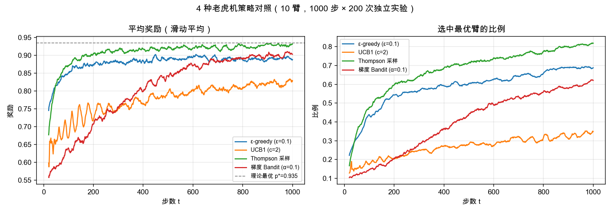
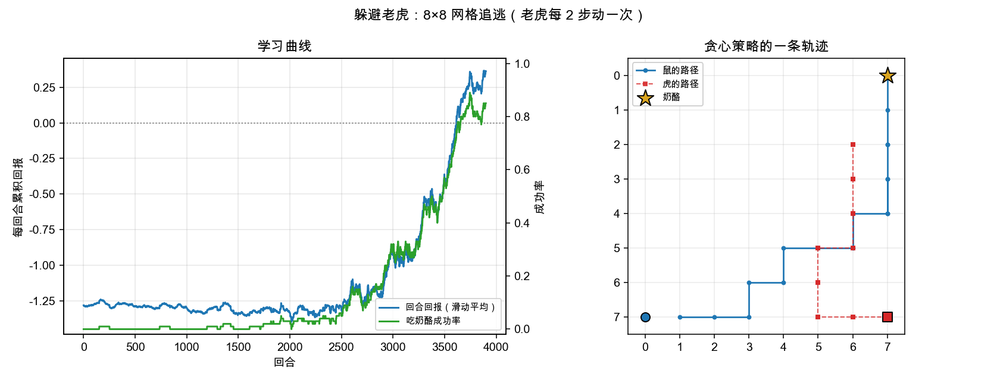

# 躲避老虎机 🐯🎰 — 两个强化学习最小可跑 demo

写给"想快速看到 RL 真的会学"的人。两个任务都是纯 Python + numpy，秒级跑完，
不需要 GPU、不需要 gym、不联网。名字是"躲避老虎"和"老虎机"的合体，因为这两个
恰好是 RL 的两个原点：**多臂老虎机**（只有选择、没有状态）和**追逃任务**（有状态、
有延迟奖励）。

## 快速开始

```bash
cd dodge_bandit
python main.py all            # 两个都跑，各出一张图
python main.py bandit         # 只跑老虎机：4 种策略对照
python main.py dodge --render # 只跑躲避老虎，并打印一条 ASCII 轨迹
python test_smoke.py          # 冒烟测试（秒级）
```

依赖：`python3` + `numpy` + `matplotlib`（画图可关：`--no-plot`）。

## ① 多臂老虎机（`bandits.py`）

10 个摇臂，各自有固定但未知的中奖率；拉 1000 次，看谁更会选。策略全部向量化，
一次推进 200 个独立实验。

实测输出（seed=0，`p* = 0.935`，瞎拉期望 `0.551`）：

| 策略 | 平均奖励 | 选中最佳臂 | 累积遗憾 |
|---|---|---|---|
| Thompson 采样 | **0.907** | 67.3% | 28.5 |
| ε-greedy (ε=0.1) | 0.879 | 58.3% | 56.3 |
| 梯度 Bandit (α=0.1) | 0.805 | 40.0% | 130.4 |
| UCB1 (c=2) | 0.774 | 26.7% | 161.5 |

几个值得注意的点：

* **Thompson 采样通常最强**：它按后验概率采样，"不确定性多大就探索多少"是自动的，
  不需要调 ε。
* **ε-greedy 简单但浪费**：ε=0.1 意味着永远有 10% 的时间在纯随机拉杆。
* **UCB1 在这里偏慢**：`c=2` 对 10 臂、1000 步来说太保守（探索项压过收益项），
  改成 `c=0.3` 左右会明显变快 —— 拿它练手调参正好。
* 遗憾只在**期望**意义下单调，单次实验会因为采样噪声抖一下。



## ② 躲避老虎（`dodge.py`）

8×8 网格追逃：鼠（A）从左下角出发去吃右上角的奶酪（C），老虎（T）从右下角出发，
**每 2 步**朝鼠的方向走一格。被抓 -1、吃到 +1、每步 -0.02，超过 80 步算超时。

状态 = `(鼠行, 鼠列, 虎行, 虎列, 步数奇偶)`，8192 个状态；动作 4 个；表格
Q-learning，4000 回合，0.5 秒训练完。

实测（500 回合评估）：

| 策略 | 吃到奶酪 | 被抓 | 平均回报 | 平均步数 |
|---|---|---|---|---|
| 随机瞎走 | 0.0% | 100.0% | -1.270 | — |
| Q-learning（贪心） | **100.0%** | 0.0% | 0.680 | 17.0 |

学习曲线是典型的 RL 形状：**前 2500 回合几乎学不到东西（成功率 ~5%），
2500 回合后突然起飞**，最后 500 回合（带 ε=0.05 探索）成功率 74%，贪心评估 100%。
这个"平台期 + 突然起飞"不是 bug，是探索终于把关键状态-动作对上打通了。

学习的策略很有意思：鼠**不是**直接往奶酪跑（那会被斜向截住），而是先沿底边横向
拉扯老虎、等它转向，再贴着右上角冲刺 —— 也就是"利用老虎移动的固定节奏"。



## 文件说明

| 文件 | 内容 |
|---|---|
| `bandits.py` | 老虎机环境 + ε-greedy / UCB1 / Thompson / 梯度 Bandit + 对照实验与绘图 |
| `dodge.py` | 追逃环境 `DodgeTigerEnv` + 表格 Q-learning + 评估 / ASCII 渲染 / 绘图 |
| `main.py` | 统一入口（`bandit` / `dodge` / `all`） |
| `test_smoke.py` | 冒烟测试：环境不变量、遗憾单调性、"学习确实有效" |
| `bandit_results.png` / `dodge_results.png` | 上面两张图，跑一次就重新生成 |

## 想继续玩，改这些地方最划算

| 改动 | 会看到什么 |
|---|---|
| `dodge.py --tiger-period 1` | 老虎每步都动，任务变难，看策略还学不学得出来 |
| `dodge.py --size 12` | 状态数从 8192 涨到 41k，体验一下"表格法开始吃力" |
| `q_learning(alpha=..., gamma=...)` | 学习率/折扣因子的经典调参实验 |
| 在 `dodge.py` 里把 Q 表换成线性函数近似 | 从表格法过渡到函数近似（DQN 的前一步） |
| `bandits.py` 里加 UCB 的 `c` 参数扫描 | 亲手做一次探索-利用的权衡曲线 |
| 把 `tiger_period` 设成随机的 | 状态不再完全可观，看看表格法怎么崩 |

## 环境要求

```bash
python3 -c "import numpy, matplotlib; print('ok')"
```

纯 CPU、无网络、无 gym 依赖；两个 demo 加起来跑完不到 10 秒（大头是 matplotlib 首次
建字体缓存）。
